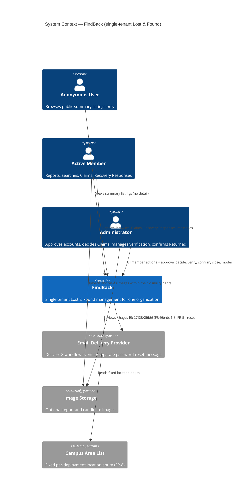

# System Context: FindBack

> Derived from the frozen PRD (§1 Vision, §2.2 Non-Users, §3 Glossary) and the
> frozen Brief (§Who This Serves). **No new product facts are introduced here.**
> Actors, boundaries, and data flows are read from those documents; anything they
> leave open is marked as an Architecture decision, not invented.

## System under discussion

A **single-tenant** web application: one organization (school, office, venue) runs
one FindBack deployment. Every account, report, Claim, and Recovery Response belongs
to exactly one organization. There is no federation, no shared pool, no marketplace,
and no multi-organization console (PRD §2.2, §5).

## Actors

| Actor | Type | Role in FindBack | Source |
|---|---|---|---|
| **Anonymous User** | Human, unauthenticated | Sees public summary listings only. Cannot report, claim, respond, or message. Cannot open item detail. | PRD §3, FR-12, FR-38 |
| **Pending User** | Human, registered, unapproved | Confirmation screen after registration. Cannot use lost-and-found features. No email at registration or rejection. | PRD §3, FR-2 |
| **Rejected User** | Human | Cannot log in. Record preserved for audit; rejection reason is **not** exposed to them and no email is sent. | PRD §3, UJ-3 |
| **Active Member** | Human | The core user. Reports Lost/Found, browses, searches, submits Claims and Recovery Responses, selects a candidate for verification on their own Lost report, posts on their threads. | PRD §3, §2.1 |
| **Deactivated User** | Human | Cannot log in. All historical artifacts preserved. | PRD §3, FR-5 |
| **Administrator** | Human (Member + `administrator` flag) | Approves/rejects registrations, deactivates accounts, reviews and decides Claims, manages Lost-side verification, records the owner's determination, confirms Returned on both sides, closes/moderates/removes reports, edits reports for moderation (FR-53), views the audit trail. | PRD §3, FR-33–FR-36, FR-50 |
| **Email Delivery Provider** | External system | Delivers the eight workflow/business events plus the separate password-reset message. Provider selection is Architecture (A6). | FR-27–FR-29, FR-46, FR-51, A6 |
| **Campus Area List** | External data (per-deployment) | Fixed enum set per deployment, referenced by report location (FR-8). Configuration mechanism is Architecture (OQ-1, A4). | FR-8, A4, OQ-1 |
| **Image Storage** | External system | Holds optional report / candidate images (≤ 5 MB, JPEG/PNG/WebP). Delivery must resist casual unauthorized access; budget and cleanup on hard delete are open (OQ-2). | FR-8, FR-37, OQ-2 |

**Explicit non-actors (out of scope, PRD §2.2 / §5):** other organizations; external
identity providers (SSO/LDAP); mobile-native clients; in-app notification service;
automated match engine; automated image moderation.

## External systems

| System | Direction | Data exchanged | Protocol |
|---|---|---|---|
| Email delivery provider | Outbound | Notification payloads for FR-27, FR-28, FR-29, FR-46 events 1–8, and the separate FR-51 reset message | Provider API (SMTP or HTTPS API — Architecture) |
| Image storage | Both | Optional report images up (FR-8), authorized reads down (FR-37) | Object storage or local FS (Architecture) |
| Campus-area configuration | Inbound at deploy time | Fixed enum values for FR-8 location field | Deploy-time config or seed (Architecture, OQ-1) |
| Host organization's SMTP/domain | Outbound | Sending domain, SPF/DKIM/DMARC alignment (Architecture) | DNS + SMTP |

## Data flows

### Inbound
- Registration, login, password-reset requests (FR-1, FR-4, FR-51).
- Lost/Found report creation and edits with the FR-8 field set; images up to 5 MB (FR-6, FR-7, FR-8, FR-9).
- Search/filter queries: keyword, category, location, date, type, status (FR-14).
- Claims with reason, identifying details, date lost (FR-15).
- Recovery Responses with the FR-44 field set (FR-40, FR-44).
- Per-Claim and per-Recovery-Response thread messages (FR-26, FR-47).
- Owner selections and determinations; administrator decisions and Returned confirmations (FR-17, FR-18, FR-23, FR-24, FR-43, FR-45).
- Password resets and administrator moderation edits (FR-51, FR-53).

**Validation at the boundary:** FR-8 field constraints; 365-day Lost date-lost bound
and 30-day Found date bound (FR-6, FR-7, FR-8, OQ-3); image type/size; anti-
enumeration on the FR-51 reset response.

### Outbound
- Rendered pages and JSON API responses, **filtered by the FR-39 visibility matrix at
  the API layer** — the FR-37 sensitive set is never returned to unauthorized viewers.
- Outbound workflow emails: exactly eight business/workflow events (FR-27, FR-28,
  FR-29, FR-46 events 1–8). No registration-rejection email, no report-edit email,
  no closure/stale-report email (FR-30, FR-46). The FR-51 reset email is separate and
  is not a ninth event.
- Application logs with request ID, actor ID, action, target ID; plus a separate log
  of **audit-trail reads** (administrator ID, query, timestamp) — PRD §10.
- Audit records: FR-31 events 1–14, FR-48 events 15–30, plus non-numbered FR-52
  profile-edit and FR-53 report-edit records. Append-only, administrator-visible.

**Guarantees:** email delivery failures are logged and **never block** the triggering
action (PRD §10 Reliability). No in-app notification stream exists.

## Context diagram

## Boundaries that Architecture must respect

1. **Found-side and Lost-side recovery are separate bounded workflows.** They share
   no state machine (PRD §1, §4.4, §4.12).
2. **Visibility is an API-layer concern**, not a rendering concern (PRD §10 Security).
3. **Audit is append-only and administrator-only**, with no deletion mechanism while
   the parent report lives (Brief §Item lifecycle; FR-31, FR-32).
4. **Terminal means terminal.** `Returned` and `Closed` block edits (FR-9, FR-53) and
   block further workflow transitions except those the PRD names explicitly.
5. **Email count is fixed at eight** workflow/business events; adding a ninth is a
   product change, not an implementation detail.

## Open Architecture-owned decisions surfaced by this context

| # | Decision | Origin |
|---|---|---|
| 1 | Runtime, framework, database, ORM | A2 / §10 (unspecified by design) |
| 2 | Session storage and revocation mechanism | A2, FR-51 "Architecture-owned" |
| 3 | Audit storage topology (same DB vs. external log) | A5 |
| 4 | Email provider and delivery guarantees | A6 |
| 5 | Campus-area enum configuration mechanism | OQ-1, A4 |
| 6 | Image storage budget + cleanup on hard delete | OQ-2 |
| 7 | Concurrent-claim-review freshness mechanism | UX-OQ-B |
| 8 | Claim-state freshness under concurrent admin review (UX-OQ-B) and audit pagination (UX-OQ-C) | `EXPERIENCE.md` §23 |